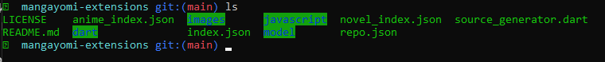
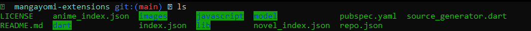

# Mangayomi Extension Developer Dart

Developer bridge library for building Mangayomi extensions in Dart.

This package provides the same models and helper APIs that are available inside
the Mangayomi extension runtime (source metadata, provider methods, filters,
parsers, HTTP client, video extractors, and preferences).

## What This Package Is For

Use this package to:

- Write extension code against Mangayomi bridge types in Dart.
- Get IDE autocomplete and type safety for provider APIs.
- Share consistent model contracts for manga, chapters, pages, videos, and
	filters.

## Relationship to Mangayomi

This package provides Dart bridge stubs for developing Mangayomi extensions.

It is not an official Mangayomi package, but it follows the same
API contracts used by the Mangayomi runtime.

## Important Runtime Note

Most bridge methods in this package are stubs that throw
`UnimplementedError` when called in plain Dart.

They are designed to be implemented by the Mangayomi host/runtime at execution
time. This means:

- Use this package as a contract layer while developing extensions.
- Do not expect full standalone behavior in a normal Dart CLI run.

## Installing

### Before
in the same directory of the extension you are working on.

> File structure before
```bash
your-extension-project/
|- extension.dart # YOUR EXTENSION
```

---
### Installation:
```sh
git clone https://github.com/5y3b/mangayomi-extension-developer-dart.git lib
cd lib
dart pub get
cp pubspec.yaml ..
cd ..

```
----
### After
> File Structure after

```bash
your-extension-project/
|- extension.dart # YOUR EXTENSION
|- pubspec.yaml
|- lib/
|  |- bridge_lib.dart
|  |- pubspec.yaml
|  |- README.md
|  |- bridge_classes/
|  |  |- document.dart
|  |  |- *.dart
|  |  |- dart/
|  |  |  |- *.dart
```

## Example Usage
In this example I will be using [mangayomi-extensions](https://github.com/m2k3a/mangayomi-extensions) repo.

After cloning it, open the project in a terminal,
now when you are inside the project directory,
which should be `mangayomi-extensions` folder

typing `ls` command should show the following


now we execute the installation commands in [#Installation](#Installation),
we should see  `lib/` and `pubspec.yaml`.


Now you should be ready to start developing extensions in dart in VSCode,
make sure to install [VSCode Flutter Extension](https://marketplace.visualstudio.com/items?itemName=Dart-Code.flutter).


## Import

```dart
import 'package:mangayomi/bridge_lib.dart';
```

`bridge_lib.dart` re-exports all bridge classes.

## License

	Copyright 2026 Abdelmonem Alsnajleh

	Portions of this project are derived from the Mangayomi project:
	https://github.com/kodjodevf/mangayomi

	Copyright 2023 Moustapha Kodjo Amadou

	Licensed under the Apache License, Version 2.0.
	You may obtain a copy of the License at:

	http://www.apache.org/licenses/LICENSE-2.0


## Disclaimer
Mangayomi is not hosting any kind of content and the developer(s) of this application does not have any affiliation with the content providers that are freely available in the internet.